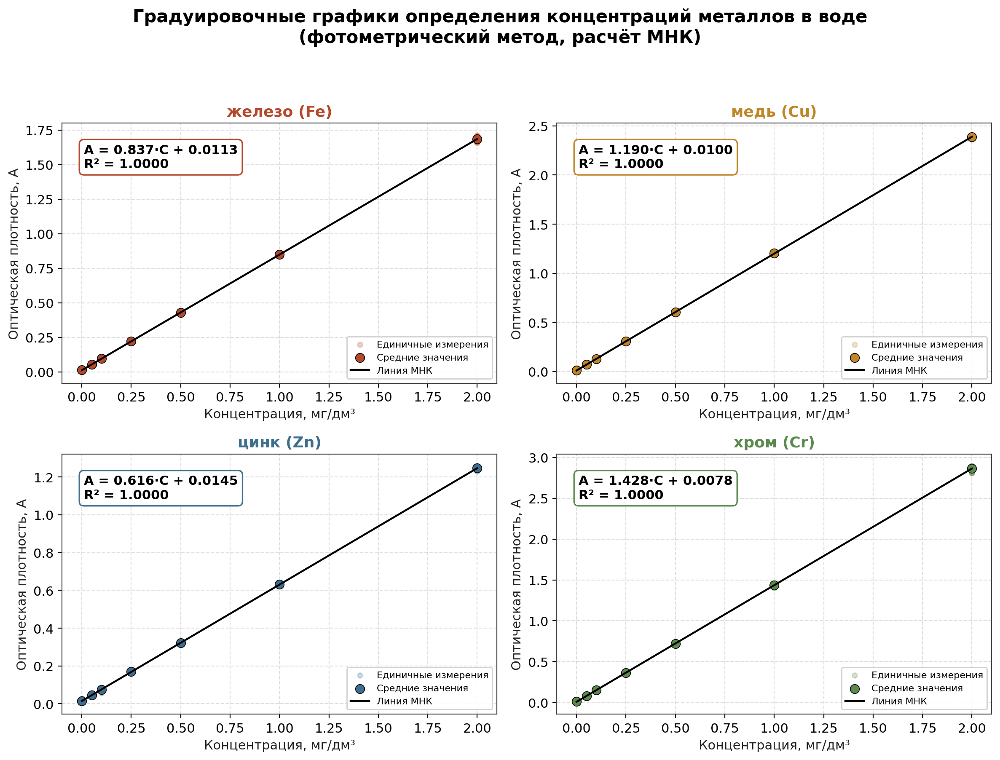

# Автоматизация расчёта градуировочных зависимостей

Кейс из работы в химико-аналитической лаборатории: автоматизация расчёта
градуировочных зависимостей калибровочного анализа концентраций металлов в воде (метод наименьших квадратов) для фотометрического
определения концентраций металлов (Fe, Cu, Zn, Cr) в воде, и перевод ручных
Excel-расчётов в шаблон с формулами + Python-пайплайн для анализа и
визуализации.

> **О данных.** Исходные измерения лаборатории защищены коммерческой тайной
> и не публикуются. Данные в этом репозитории - синтетические (т.е. искусственно сгенерированные, имитируют структуру и паттерны реальных результатов), но
> воспроизводят реальную структуру данных (сессии градуировки, параллельные
> измерения, диапазоны стандартов) и реальную методологию расчётов, которые
> использовались в работе.



## Задача

- Автоматизировать занесение и агрегацию результатов измерений (сотни
  значений: параллельные пробы, разные сессии градуировки, разные аналиты).
- Рассчитывать градуировочную зависимость `A = k·C + b` методом наименьших
  квадратов и получать тангенс угла наклона (k), свободный член (b) и
  коэффициент детерминации (R²) для контроля качества градуировки.
- Создать инструмент, который автоматически пересчитывает концентрацию неизвестной пробы
  по измеренному сигналу без ручного расчёта.
- Визуализировать градуировочные графики для отчётности.

## Результат

| Металл | k (тангенс угла наклона) | b (свободный член) | R² |
|---|---|---|---|
| Fe | 0.8373 | 0.0113 | 0.99999 |
| Cu | 1.1898 | 0.0100 | 0.99999 |
| Zn | 0.6160 | 0.0145 | 0.99999 |
| Cr | 1.4278 | 0.0078 | 1.00000 |

Все градуировки - R² ≥ 0.9999, что соответствует требованиям методик к
линейности градуировочной зависимости.

## Структура репозитория

```
metal-calibration-analytics/
├── data/
│   └── raw_measurements.csv        # синтетический журнал измерений (420 строк)
├── src/
│   ├── generate_data.py            # генерация синтетического датасета
│   └── calibration_analysis.py     # агрегация, МНК-регрессия, график
├── excel/
│   ├── build_excel.py              # сборка Excel-шаблона из данных
│   └── calibration_workbook.xlsx   # готовый Excel с формулами
├── results/
│   ├── calibration_summary.csv     # сводные коэффициенты по металлам
│   └── graduation_curves.png       # итоговый график
├── requirements.txt
└── README.md
```

## Как это устроено

**`data/raw_measurements.csv`** — журнал измерений: 4 металла × 5 сессий
градуировки × 7 стандартных концентраций × 3 параллельных измерения = 420
строк. Имитирует реальный лабораторный журнал в Excel.

**`src/calibration_analysis.py`**
1. Агрегирует параллельные измерения и сессии (`pandas.groupby`), как того
   требует методика - усреднение перед построением графика.
2. Строит регрессию МНК (метод наименьших квадратов) через `scipy.stats.linregress` для каждого металла.
3. Строит 2×2 сетку градуировочных графиков (`matplotlib`) с подписанным
   уравнением прямой и R² на каждом.

**`excel/calibration_workbook.xlsx`** - тот же процесс в Excel:
- лист `Данные` - сырой журнал измерений;
- лист `Градуировка` - среднее по концентрации через `AVERAGEIFS`,
  коэффициенты через `SLOPE` / `INTERCEPT` / `RSQ`;
- лист `Расчёт_пробы` - калькулятор: можно выбрать металл и ввести измеренную
  оптическую плотность пробы, концентрация посчитается автоматически
  (`INDEX/MATCH` + формула `C = (A − b) / k`).

Таблица пересчитывается сама при добавлении новых измерений в лист `Данные`.

## Как запустить

```bash
git clone <ваш-репозиторий>
cd metal-calibration-analytics
pip install -r requirements.txt

python src/generate_data.py          # генерирует data/raw_measurements.csv
python src/calibration_analysis.py   # считает регрессию и строит график
python excel/build_excel.py          # пересобирает Excel-шаблон из данных
```

## Стек

`Python` (pandas, numpy, scipy, matplotlib) · `Excel` (SLOPE, INTERCEPT, RSQ,
AVERAGEIFS, INDEX/MATCH, проверка данных) · метод наименьших квадратов ·
методология градуировки по типу ПНДФ.

## Лицензия

[MIT](LICENSE)
